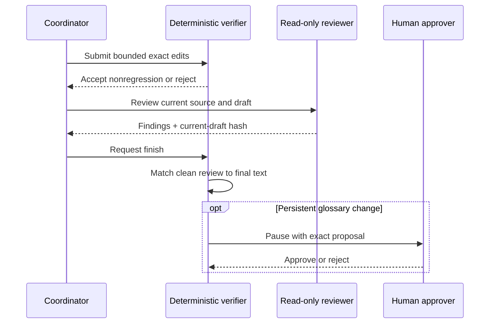

# Agentic Translation Reliability Harness


[](https://github.com/MrEricL/public-tl-harness/actions/workflows/harness-v3.yml)

[](LICENSE)

This source-grounded agent harness translates long Chinese web novels while
keeping names and terms stable across chapters. Source memory carries the
story's context forward; a translator's glossary controls its vocabulary.
Models propose drafts and repairs, and trusted code checks and records each edit.

## 62.5% fewer inconsistent name and term renderings

Translated one chapter at a time, a character called 伊文 came out six different
ways in ten chapters: Irwin, Evan, Ivan, Ewen, Evin, Erwin. With the harness, he
was "Evan" every time.

The consistency evaluation was specified before translating 40 held-out
chapters from four Chinese web novels. Every arm used the same writer model,
DeepSeek Flash. The measured result is a 2.7× reduction in inconsistency:

| Measure | Chapter only | + memory and glossary | + guarded repair |
| --- | ---: | ---: | ---: |
| Extracted term–chapter observations using the term's usual rendering | 561 / 851 (65.9%) | 734 / 854 (85.9%) | 744 / 853 (87.2%) |
| Recurring terms rendered more than one way | 116 / 160 | 61 / 160 | 62 / 160 |
| Estimated API cost per chapter, at measured off-peak rates | $0.0021 | $0.0066 | $0.0168 |

Consistency improved in all four held-out works, by 15.3–27.4 percentage
points. Of 72 terms that the chapter-only baseline rendered three or more
ways, the full harness rendered 39 exactly one way. At these chapter lengths
and off-peak rates, the full profile costs about $17 per 1,000 chapters.

Source memory and the glossary account for about 94% of the observed gain;
repair supplies an inspectable way to correct remaining problems. The measured
benefit is terminology consistency. Overall chapter-quality judgments were
mixed: 14 wins, 9 ties, and 17 losses against chapter-only translation.
[Results](docs/RESULTS.md) gives every arm, work-level counts, judge coverage,
costs, and the extraction limits.

Recompute the headline from the published aggregate counts, with Python alone:

```bash
python experiments/heldout_evidence/verify.py
```

The [evidence bundle](experiments/heldout_evidence/README.md) contains no chapter
text, glossary entries, or per-term records. It verifies the saved arithmetic;
the live demo below lets you inspect the behavior on your own text.

## Contents

- [Try it](#try-it)
- [What makes it a harness](#what-makes-it-a-harness)
- [How repair works](#how-repair-works)
- [Same tools, different harnesses](#same-tools-different-harnesses)
- [What changed after measuring](#what-changed-after-measuring)
- [Optional Jev semantic checks](#optional-jev-semantic-checks)
- [Why I built this](#why-i-built-this)
- [Documentation](#documentation)
- [Development](#development)

## Try it

Python 3.11 or newer is required. Install from the repository root:

```bash
python -m venv .venv
source .venv/bin/activate
python -m pip install -U pip
python -m pip install -e '.[dev]'
```

No API key? Run the offline walkthrough. It uses scripted model decisions to
show translation, repair, an auto-approved glossary change, and TXT/EPUB
delivery; it is not a quality measurement. Replay then reproduces the run
without model calls:

```bash
python demo.py --offline --out runs/offline-demo --open
python -m agentic_translation harness replay runs/offline-demo --out runs/offline-demo-replay
```

Translate your own folder of Chinese chapters with one OpenAI-compatible key.
The script asks for the folder (drag it into the terminal), provider, model ID,
and a hidden key; presets cover OpenAI, Anthropic's compatibility endpoint,
DeepSeek, OpenRouter, and custom endpoints:

```bash
python demo.py
```

The `harness` commands use the `openai` and `deepseek` profiles (other
OpenAI-compatible endpoints via `OPENAI_BASE_URL`); supply credentials through
environment variables or `--env-file`. A live run can record provider
responses to a local cache such as `.agentic_cache` for later replay. The cache
holds prompts, source excerpts, and responses, so it should not be committed.

To see where the gains come from, compare plain translation → glossary prompting
→ source memory → bounded repair on the bundled story:

```bash
python demo.py --provider deepseek --model YOUR_MODEL \
  --source samples/showcase/source \
  --glossary samples/showcase/terms/demo_glossary.json \
  --compare --out runs/my-comparison --open
```

The local report shows category-level gains and regressions, every draft side
by side, exact edits, warnings, model calls, and the delivered book. A second
short test, `--repair-bench`, checks repairs of ten seeded meaning errors and
two clean controls. See the [try-it guide](docs/TRY_IT.md) and the
[two focused tests](experiments/portfolio_demo/README.md).

`demo.py` uses the same building blocks as the measured harness (source
memory, the translator's glossary, batched alignment, and guarded passage
review) without Jev routing. It is not the frozen configuration measured in
Results, whose runner reads the private corpus and is not published.

For book workflows, two named policies make the cost/repair choice explicit:

| Policy | What it does |
| --- | --- |
| `contextual.v1` (`--strategy contextual`) | Source memory and glossary prompting, with deterministic checks and no model review or repair |
| `portfolio-review.v1` (`--strategy portfolio-review`) | Adds terminology alignment and guarded passage review, using the same policy as `demo.py`; experimental |

The historical context ablation captured about 94% of the consistency gain at
39% of the full harness's estimated cost. That motivates the contextual option;
it is not a new cost measurement of these policies. See the
[operator guide](USER_GUIDE.md) for complete book commands. Older adaptive
strategies are explicitly labeled legacy.

## What makes it a harness

- **The model proposes; code disposes.** Typed actions and exact edits are
  validated against target text and hashes, then applied as bounded atomic
  patches to a working copy. In `portfolio-review.v1`, edits that shrink a
  passage sharply, drop source numbers, add translator glosses, duplicate
  text, or regress QA are rejected.
- **Source-grounded story memory.** A causal memory built only from the Chinese
  source records names, terms, and facts as chapters arrive, with provenance
  for every entry. The translator's glossary takes precedence.
- **Fresh-review gate.** In the interactive `harness run` workflow, a chapter
  completes only after a clean fidelity review whose SHA-256 matches the final
  draft; any later edit invalidates it. The unattended long-horizon path
  instead delivers with recorded warnings when review is unavailable or a
  screen flag stays unresolved.
- **One tool surface for any harness.** The chapter-repair tools are exposed as
  a CLI and a dependency-free MCP stdio server, so this project's loop, Claude
  Code, and Codex drive identical guarded tools.
- **Replayable, resumable runs.** Provider calls, decisions, and checkpoints
  are recorded. Cache-only replay reproduces a run without network calls. The
  interactive workflow pauses persistent glossary changes for approval and
  resumes only against a matching session.
- **Fail-fast providers.** Each demo call has a total deadline, and a run with
  missing output reports "No score" instead of a misleading delta.

## How repair works

In the interactive `harness run` workflow, automatic repair is the default.
A coordinator chooses typed actions; read-only specialists review terminology
and fidelity. Python validates each action, applies edits to a working copy,
and checks the result before accepting it.



| Control | Behavior |
| --- | --- |
| Bounded edits | Exact, single-occurrence replacements in atomic bundles; step and mutation budgets limit the loop. |
| QA gate | A changed draft is accepted only when QA does not regress or introduce a new finding. |
| Guards (`portfolio-review.v1` and folder demo) | Patches that shrink a passage by more than 30%, drop a number printed in the source, add parenthetical glosses or slash alternatives the source lacks, or copy an existing paragraph are rejected. The harness-lab tools apply the shrink/number check. |
| Final review (interactive workflow) | Completion requires a nonblocking fidelity review whose SHA-256 matches the current draft. Any edit invalidates the earlier review. |
| Glossary approval (interactive workflow) | The coordinator proposes persistent terminology changes; a human approves them before the run continues. |
| Resume identity | Source, glossary, provider, tools, instructions, and policies must match the saved session. |
| Replay | Saved provider decisions reproduce the run. Missing or mismatched records fail without falling back to live calls. |

For the current review profile, source memory feeds each chapter's draft;
batched glossary alignment and full passage review then propose bounded
repairs. The contextual profile delivers the contextual draft with deterministic
checks. The [operator guide](USER_GUIDE.md) covers batch workflows,
review queues, and TXT/EPUB packaging, and the
[repair contract](docs/AUTOMATIC_REPAIR.md) states the editing and review rules.

The authored, credential-free repair demo pauses at the approval boundary:

```bash
python -m agentic_translation harness run \
  --story samples/synthetic_repair_demo/story.yaml \
  --out runs/synthetic-repair
python -m agentic_translation harness resume runs/synthetic-repair \
  --approve --reviewer demo
python -m agentic_translation harness replay runs/synthetic-repair \
  --out runs/synthetic-repair-replay
```

## Same tools, different harnesses

The same seven chapter tools—list, read, search, glossary lookup, exact edit,
guarded rewrite, and done—have been driven by this project's native loop,
Claude Code, and Codex. The tool boundary owns mutation and QA, so each driver
uses the same editing contract. Point a driver at a task directory created
with `ToolSurface.create_task`:

```bash
python -m agentic_translation.mcp_server --task runs/task       # MCP stdio server
python -m agentic_translation.tools_cli --task runs/task list_segments   # shell-only harnesses
```

The [six-chapter lab](docs/RESULTS.md#harness-lab-same-tools-different-harnesses)
records accepted and rejected edits and chapter judgments for each setup.
Models and judges differed between conditions, so those results describe the
complete setups rather than isolating a harness effect. The lab runner itself
is not included because its tasks come from private chapters.

## What changed after measuring

- **The strict verifier refused correct repairs.** On 252 short repair trials,
  the first harness delivered 11 of 36 faithful outputs where direct prompting
  delivered 36 of 36. Its verifier accepted an edit only if a rule score
  improved, so it held all twelve semantic-error trials instead of repairing
  them. Accepting QA-neutral meaning repairs with a fresh source review then
  fixed 10 of 10 targeted meaning errors.
- **Classical fiction hid the problem.** A first run on public-domain classics
  barely changed any text, so the evaluation moved to web novels, where names
  and terms are invented and drift is common.
- **Memory and repair could make chapters worse.** Development judges flagged
  glosses inside memory terms, literal names locked in early, and repairs that
  overrode the source. Each became a versioned fix: cleaner memory terms, the
  translator's glossary taking precedence, and guards against glosses and
  duplicated text.
- **Only then was the held-out set run, once,** with the configuration and
  primary outcomes written down first.

## Optional Jev semantic checks

Jev adds source-aware judgments to the repair loop. It answers narrow questions
about missing content, unsupported additions, actor/action roles, negation,
and source ambiguity. The repair model receives typed probabilities alongside
the normal QA findings. Choose five focused questions or eighteen dense
questions; shadow mode records the signals, and advisory mode shares them with
the coordinator.

Jev is off by default. It supplies signals rather than edits, and final
fidelity review still applies. In the unattended workflow it can instead route
passages to review; on the held-out novels its development thresholds routed
62% of passages, so routing did not save money there. See the
[Jev guide](docs/JEV_EXTENSION.md) and its
[aggregate evidence](docs/JEV_EXTENSION.md#aggregate-evidence).

## Why I built this

I've always been a big fan of stories from China, Japan, and Korea, and the
biggest bottleneck was the shortage of translators. There was a huge buffet of
stories, but only a trickle made it into English.

LLMs made most chapters readable, and the issue became long-term coherence. Web
novels run for hundreds of chapters, beyond what a context window can hold.
This is a big issue in fantasy stories, where names carry worldbuilding: a
technique called **Moon-Shadow Step** might turn into **Lunar Shadow Footwork**,
or the **Azure Cloud Sect** might show up later as the **Blue Cloud School**.
Choosing that language is where a translator has the most influence, so it has
to stay stable.

My goal is to drop in a story and get back an English edition I can read on the
train.

## Documentation

| Read | For |
| --- | --- |
| [Results](docs/RESULTS.md) | Every arm, judging, costs, harness lab, and limits |
| [Recompute the evidence](experiments/heldout_evidence/README.md) | Published counts and a no-key verification command |
| [Try-it guide](docs/TRY_IT.md) | Keys, providers, file formats, limits, and replay |
| [Two focused tests](experiments/portfolio_demo/README.md) | Terminology gains by category and seeded semantic repair |
| [Operator guide](USER_GUIDE.md) | Batch, live, and replay operations |
| [Automatic repair contract](docs/AUTOMATIC_REPAIR.md) | Editing, QA, and review rules |
| [Jev guide](docs/JEV_EXTENSION.md) | Configuration and evaluation |
| [Session identity](docs/SESSION_IDENTITY.md) | Resume guarantees |
| [Demo script](DEMO_SCRIPT.md) | A two-minute walkthrough |
| [Five-chapter benchmark](experiments/mid_corpus_harness_benchmark/README.md) | An earlier paired benchmark |
| [Data notice](DATA_NOTICE.md) | What is and is not distributed |
| [Changelog](CHANGELOG.md) | Release history |

The demos exercise control flow with authored fixtures and scripted model
decisions. A clean model review does not guarantee a correct translation. Keep
credentials, private text, generated `runs/`, and live response caches out of
commits.

## Development

To read the implementation, start with the folder CLI in
[`agentic_translation/demo.py`](agentic_translation/demo.py), the shared policies
in [`profiles.py`](agentic_translation/profiles.py), causal memory in
[`story_memory.py`](agentic_translation/story_memory.py), and the guarded
passage loop in [`adaptive.py`](agentic_translation/adaptive.py).
[`unattended.py`](agentic_translation/unattended.py) connects the model adapters
to that loop; [`structured_transport.py`](agentic_translation/structured_transport.py)
handles structured model calls.
[`tool_surface.py`](agentic_translation/tool_surface.py) exposes the shared
chapter-editing tools to external harnesses.

```bash
python -m pip install -e '.[dev]'
python -m pytest -q
```

CI runs the package tests on Python 3.11 and 3.13, the benchmark checks, and
the credential-free demos.
