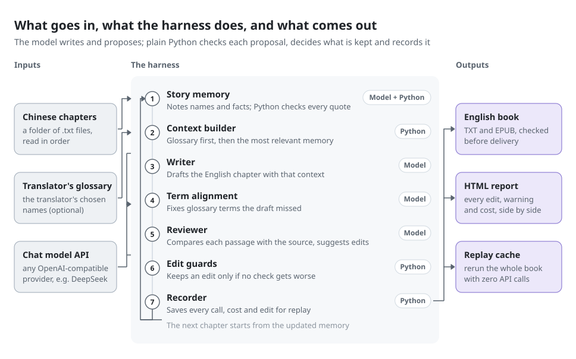
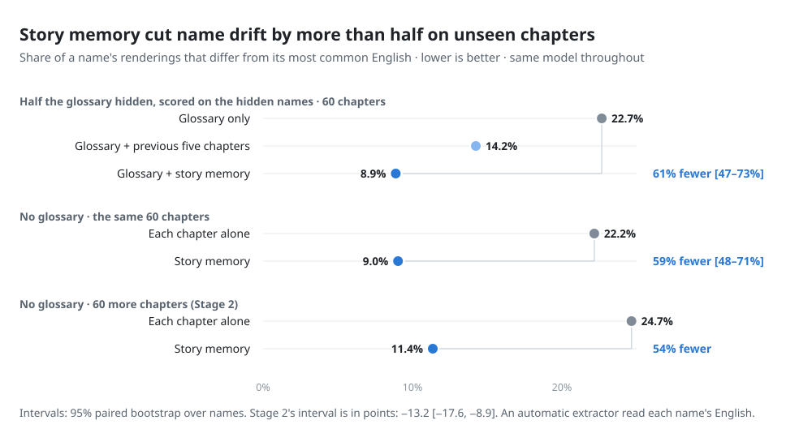
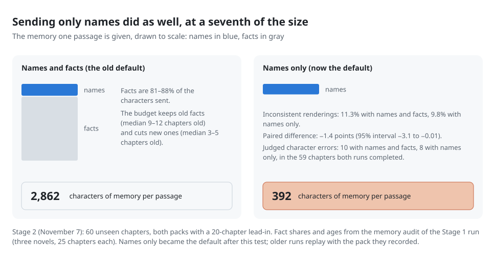

# Agentic Translation Reliability Harness

An agent harness for translating long Chinese web novels while keeping names
and invented terms stable across chapters. It carries a source-checked story
memory and the translator's glossary between chapters; models propose edits,
and Python checks and records each change.

On 120 unseen chapters with no glossary, source memory cut name changes by
**68%**, compared with translating each chapter alone: 60% on the first 60
chapters and 76% on the next 60. A name change is a different English name
for the same thing; a plural, or a longer phrase around the name, doesn't
count. As first scored, on a different sample of names and with plurals
counted as changes, the two tests gave **59% and 54%**. A separate comparison showed that with names only,
memory sends **392 characters per passage instead of 2,862**, with no loss
in naming consistency or judged character errors. Every test fixed its plan
and pass/fail rules before the calls it scored. These are consistency
results; overall translation quality was not shown to be better.

[](https://github.com/MrEricL/public-tl-harness/actions/workflows/harness-v3.yml)

[](LICENSE)

<picture>
  <source media="(prefers-color-scheme: dark)" srcset="assets/readme/hero-dark.svg">
  
</picture>

[Problem](#what-it-solves) · [Design](#how-it-works) ·
[Memory](#how-memory-works) · [Results](#results) ·
[Timeline](#what-i-built-and-when) · [Try it](#try-it) · [Limits](#limits)

## What it solves

Web novels arrive a chapter at a time and can run for hundreds of chapters.
Translating each one alone lets names drift: in the first test (September
2026), one character, 伊文, was rendered six ways over ten chapters. Sending every earlier chapter with each
request keeps growing the prompt. This harness instead carries a small chosen
context into each passage.

The translator's glossary controls approved vocabulary. Source memory tracks
names and facts from the Chinese, with exact quotations checked by code.
The model writes a draft and proposes repairs; the executor validates each
change and keeps its evidence. The output is an English TXT/EPUB book and a
report showing context, edits, warnings, and available usage and cost data.

**Reading the results:** a *rendering* is one chapter's English for one name.
It is *inconsistent* when it differs from that name's most common English in
the same setup. A *passage* is the part of a chapter sent in one call; its
memory lines are the *pack*. A *lead-in* supplies earlier source chapters to
memory without translating them. A registered test fixes its plan and decision
rules before the scored calls.

## How it works

<picture>
  <source media="(prefers-color-scheme: dark)" srcset="assets/readme/system-dark.svg">
  
</picture>

1. **Remember.** A model proposes names and facts from the source. Python
   checks their quoted evidence and records when they became available.
2. **Choose context.** The translator's glossary goes first, then matching
   memory names within a 3,000-character memory budget per passage.
3. **Write and check.** The model drafts the translation. Deterministic checks
   identify glossary and structural issues.
4. **Review and repair.** The full demo aligns the translator's names and asks
   for source review. The executor checks exact targets, content guards, and
   budgets before applying a proposed change.
5. **Record and deliver.** Calls, outcomes, context receipts, and edits are
   saved with TXT/EPUB delivery. A saved folder run can replay without API calls.

The local workbench and the folder command share one run engine.
[Process](docs/HOW_IT_WORKS.md) · [Code map](docs/CODE_MAP.md)

## How memory works

<picture>
  <source media="(prefers-color-scheme: dark)" srcset="assets/readme/memory-flow-dark.svg">
  
</picture>

| Layer | What it holds | Who changes it |
| --- | --- | --- |
| Run record | Calls, usage, edits, and snapshots | Python appends records |
| Story memory | Names and facts with source quotations | A model proposes; Python validates and records |
| Translator's glossary | Approved English names | The translator |
| Passage context | Glossary lines and selected memory names | Python selects them within the budget |

New runs send **names only** from memory. Facts remain stored, and older runs
replay with their recorded settings. Compatible compound names can survive
alongside glossary entries; conflicting memory names yield to the glossary.
Memory respects when source evidence became available and never reads a later
chapter. A checked quotation proves provenance, not a correct interpretation.

For installments, `demo.py --memory-from RUN` continues a saved memory tape.
`--lead-in N` reads the first N source files into memory and translates the rest.
Both are recorded for replay. [Memory rules and measurements](docs/MEMORY.md)

## Results

The three registered tests, and a fourth that rescored two of them with a
corrected count, used the same DeepSeek Flash writer at temperature 0 in
every setup they compared. The November tests average inconsistency over
names, then over novels; September's rate counts renderings directly, so the
three headline rates aren't directly comparable.

| Test | Material | Main result |
| --- | --- | --- |
| September 2026 | 40 held-out chapters, four novels, supplied glossary | 62.5% fewer inconsistent renderings with the full harness; memory and glossary were combined |
| Stage 1, November 2 | 60 unseen chapters, three novels | 59% fewer without a glossary; 61% fewer on names hidden from a half glossary |
| Stage 2, November 7 | 60 fresh chapters from the same three novels | Memory's no-glossary result held: 54% fewer. Names only did no worse in a separate comparison |
| Corrected count, November 10 | The same 120 chapters, scored on 220 names no test had read | Counting only real name changes, 68% fewer with memory [58%, 78%]; 52% by the original count on the same names |

<picture>
  <source media="(prefers-color-scheme: dark)" srcset="assets/readme/november-dark.svg">
  
</picture>

### Counting only real name changes

The tests above compare renderings as exact strings. So "ghoul" against
"ghouls" counts as inconsistent, and so does "ghoul" against "ghoul king"
where the Chinese is a longer compound (食尸鬼 inside 食尸鬼王). A reader
wouldn't call either a change of name.

I fixed a corrected count before testing it: two renderings are the same
name if they differ only by a plural, a possessive, a hyphen or a space, or
if one is the name's most common rendering inside a longer phrase. Then I
scored it on 220 names that no earlier test had read, using the
translations Stages 1 and 2 had already made. The names come from my
glossaries, which these setups never saw. The plan and its pass/fail rules were frozen before
any call.

| Chapters, fresh names | Original count: each chapter alone → memory | Corrected count: each chapter alone → memory |
| --- | --- | --- |
| Stage 1's 60 (108 names) | 26.7% → 14.2%, 47% fewer [35%, 58%] | 18.1% → 7.3%, 60% fewer [45%, 74%] |
| Stage 2's 60 (112 names) | 29.4% → 12.5%, 57% fewer [45%, 68%] | 20.7% → 5.0%, 76% fewer [62%, 89%] |
| Both together | 52% fewer [44%, 60%] | 68% fewer [58%, 78%] |

On Stage 2's chapters, each change was added on top of the last (112 fresh
names; 107 in step 3, where one chapter has no translation):

| Step | What changed | Name changes | Rate | Rate by the original count | What this step did |
| --- | --- | ---: | ---: | ---: | --- |
| Start | Each chapter translated alone | 91 of 485 renderings | 20.7% | 29.4% | |
| 1 | + story memory (names and facts, after reading 5 earlier chapters) | 28 of 500 | 5.0% | 12.5% | −15.7 points [−20.2, −11.5]. The only step with a measured effect. |
| 2 | + a longer lead-in (20 earlier chapters) | 30 of 499 | 4.4% | 11.8% | −0.6 points [−3.0, +1.9]. No measurable change. |
| 3 | + memory sends only its names, not its facts (the current default) | 20 of 486 | 3.1% | 10.7% | −1.5 points [−3.2, +0.1]. No worse, with a seventh of memory's text. |

<picture>
  <source media="(prefers-color-scheme: dark)" srcset="assets/readme/steps-dark.svg">
  
</picture>

- **Steps 1 to 3 are all the same story memory.** Nothing in it is written
  by hand: a model reads each Chinese chapter and proposes names with their
  English, and Python keeps a name only if its quote is in the source. No
  glossary was given in this test. Step 3 changes only what memory sends
  with each passage: one line per name that appears in it, without the
  facts.
- **Only step 1 is a measured effect.** Steps 2 and 3 are about the size
  of the noise: translating each chapter alone twice, with the same
  prompts, differed by 1.4 points. The rate averages over names and then novels, so it can move
  differently from the raw count.
- **A separate judge model agreed with what the corrected count merges.**
  GPT-6 Luna, reading each pair blind, called all 65 plural or spacing pairs
  the same name, and 48 of 51 longer-phrase pairs. The rule set in advance
  allowed at most 10% of each kind to be called different. The judge's
  instructions stated the same two definitions, so this checks how the
  count applies them, not the definitions themselves.
- **The corrected count is still strict.** Of the 243 pairs it keeps as
  name changes, the judge called 118 the same name. I haven't checked those
  pairs myself.
- **What this doesn't show.** These are fresh names on chapters already
  tested, not fresh chapters. Merging renderings in both setups tends to
  raise the relative cut whatever is merged, so the larger cut doesn't prove
  the count is right. The evidence for the count is the judge's agreement,
  plus my own check of 38 pairs, which isn't done yet. The plan had the top
  of this page wait for that check. I moved the corrected count up on
  November 10 before doing it, with the original figures beside it, and
  I'll report the check here whichever way it comes out. Fifty of the 220
  names are in both blocks and are counted once per block.

### Stage 1 and Stage 2 in detail

In Stage 1, half of the glossary was hidden: each term was hidden in one of two
runs and given in the other, and a name was given only after the story had
introduced it. On hidden names, memory beat the previous five chapters' English by
**5.0 percentage points [2.4, 7.8]** on the same paired units.

Stage 2 tested new chapter blocks with no supplied glossary:

| Comparison | Inconsistency | Paired difference, 95% interval | Registered decision |
| --- | ---: | ---: | --- |
| Each chapter alone → memory with names and facts; five-chapter lead-in | 24.7% → 11.4% | −13.2 points [−17.6, −8.9] | Memory replicates |
| Names and facts → names only; both with 20-chapter lead-in | 11.3% → 9.8% | −1.4 points [−3.1, −0.01] | Names-only meets the no-worse rule |
| Five → 20 lead-in chapters; names and facts | 11.4% → 11.3% | −0.1 points [−2.5, +2.4] | Longer lead-in does not meet the improvement rule |

<picture>
  <source media="(prefers-color-scheme: dark)" srcset="assets/readme/pack-dark.svg">
  
</picture>

Names-only reduced **memory's payload by 86%**, not the whole prompt or bill.
The rule allowed at most +1.5 points of inconsistency at the interval's upper
end and at most three additional judged character errors. It passed both.
The rule tested only "no worse", so I don't count the 1.4-point drop as a gain.

Memory cost about $0.0085 per chapter in Stage 1, against $0.0017 without it.
Stage 2's memory runs cost $0.0058–$0.0072 per chapter, at dated DeepSeek
prices.

### What failed, and what changed

- **Memory was not reaching the writer.** In the September test, memory's
  name reached the prompt for only 25 of 78 checked occurrences (32%). After
  passing known names into extraction, raising term slots from 12 to 24 and
  keeping compatible compound names, 572 of 662 hidden-name occurrences in
  Stage 1 (86%) had memory's line in every passage.
- **Most prompt memory was facts.** A saved-run audit found facts used 81–88%
  of memory characters. The pack kept older facts while cutting newer ones.
  A 15-chapter development pilot cut the pack from about 2,449 to 217
  characters with no observed loss, which led to the names-only test above.
- **More history did not solve adherence.** A 20-chapter lead-in raised naming
  delivery from 88% to 93%, without an established consistency improvement.
- **Patching names could damage the passage.** One blind judge rated 29 of
  42 word-swap patches worse and eight better; for whole-sentence rewrites,
  21 of 45 were worse and seven better. These are development pilots, with
  human validation pending. Alignment now targets the translator's names.

<picture>
  <source media="(prefers-color-scheme: dark)" srcset="assets/readme/delivery-fix-dark.svg">
  
</picture>

[Results and methods](docs/RESULTS.md) gives denominators, amendments,
missing outputs, costs, and judgment limits. November evidence is reported as
text; source material and study execution files remain private. The existing
[anonymous evidence bundle](experiments/heldout_evidence/README.md) verifies
**September's** aggregate arithmetic with no model calls:

```bash
python experiments/heldout_evidence/verify.py
```

## What I built, and when

- **September:** source memory, guarded repair, recorded calls and replay,
  and the first registered test. Strict edit rules rejected meaning fixes, so
  the policy changed to allow QA-neutral repairs with a fresh review.
- **October:** the folder workflow, authored comparisons, anonymous evidence
  for the September result, and a local workbench for starting and inspecting
  runs.
- **November 2:** found that memory's names reached the prompt only 32% of the
  time, fixed extraction and selection, and measured memory on its own in
  Stage 1.
- **November 2–3:** naming taste. When three models agree on a name blind,
  it's my glossary's name 88% of the time; my approved names, given as
  examples, moved models toward my wording more than a style brief did.
- **November 7:** audited the memory pack, tested names only and a longer
  lead-in on fresh chapters (Stage 2), made names only the default, added
  carried memory, narrowed term alignment and fixed failure-state handling.
- **November 7:** sized "dreaming", an offline pass that would correct
  memory's names, before building it. It could fix about 15 of the 51
  inconsistent renderings left in Stage 1, so it isn't built.

- **November 10:** audited the consistency count itself. It treated plurals
  and longer phrases as name changes. A corrected count, fixed before
  testing and scored on 220 names no test had read, gives 68% fewer name
  changes with memory, against 52% by the original count on the same names.

Earlier command-line tools and research code are not in this release; this
tree is the folder demo, the workbench and the book runner.

## Try it

Use Python 3.11 or newer and run from a source checkout:

```bash
python -m pip install -e .
python demo.py
```

Enter a chapter folder, provider, model ID, and key at the prompts. Press Enter
at the folder prompt for the authored three-chapter sample. To use the local UI:

```bash
python -m agentic_translation.workbench --open
```

The workbench starts a live run, shows activity, supports a stop request, and
opens chapter diffs, naming checks, memory receipts, and saved runs. A live
translation requires API access. A completed folder run replays without a key:

```bash
python demo.py --replay runs/try-it --out runs/replayed --open
```

[Try it](docs/TRY_IT.md) covers custom endpoints, budgets, comparisons, carried
memory, and the book CLI. Run folders contain your source and model responses;
keep them private.

## Limits

Consistency can preserve an unwanted or incorrect name. An exact source quote
checks provenance, and deterministic guards check specific failure patterns;
neither certifies meaning or style. Studies used one writer and a few fixed
novels. Stage 2 tested the writer, while the names-only default also affects
the reviewer's context; that reviewer change has not been independently
validated. Translator-only alignment narrows its targets without establishing
that all resulting edits are harmless. In September, two blind judges did not
prefer the full harness over translating each chapter alone: 14 wins, 9 ties
and 17 losses.

Pending checks: human validation of the rendering extractor, my own check of
the corrected count's merges, the Stage 1 meaning-error guardrail, a blind
naming self-test, and human review of the alignment judge. Overall literary-quality superiority remains unestablished.

## About

I'm Eric, a web-novel translator who builds agent harnesses. If you're hiring
for this kind of work, I'd be glad to walk you through it:
[github.com/MrEricL](https://github.com/MrEricL).

## Start reading the code

Start at `demo.py` → `agentic_translation/demo.py:run_folder`, then follow
`unattended.py`, `story_memory.py`, and `adaptive.py`. The workbench calls that
same engine. [Code map](docs/CODE_MAP.md) explains the support modules.

```text
agentic_translation/   Runtime, providers, guards, memory, and local UI
samples/showcase/      Authored three-chapter story and glossary
experiments/           Historical aggregate evidence and authored repair checks
tests/                 Tests of the shipped runtime and public documentation
docs/                  Results, process, memory, and usage
```

Install development tools with `python -m pip install -e '.[dev]'`, then run
`python -m pytest -q`. [Data notice](DATA_NOTICE.md) · [License](LICENSE)
