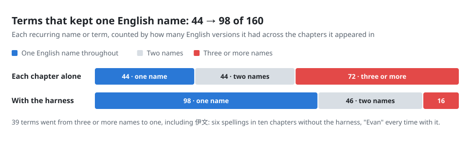
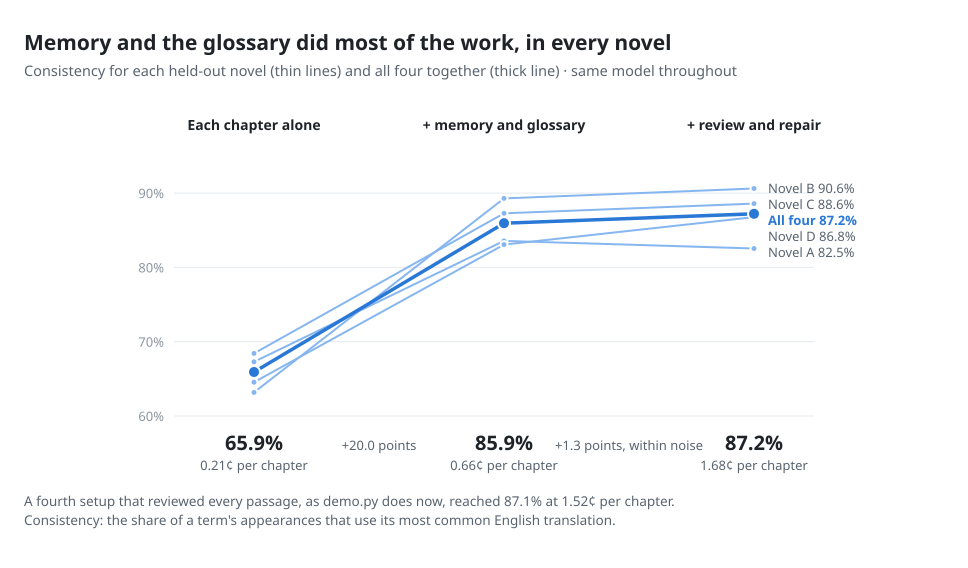
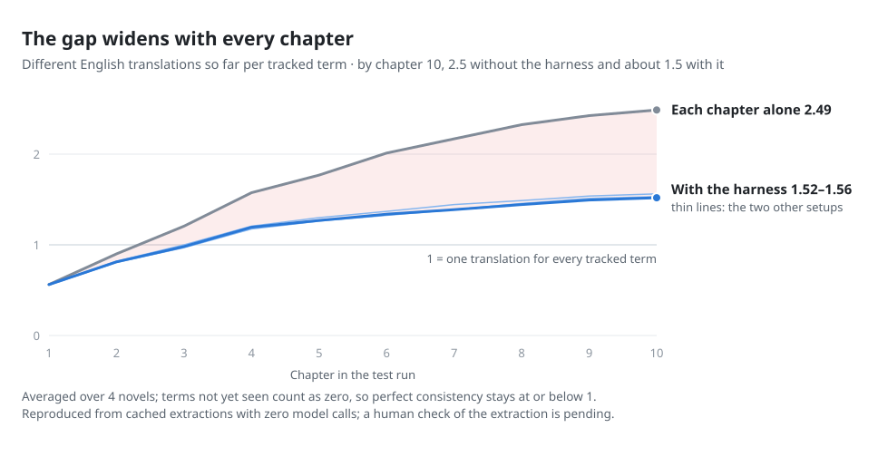
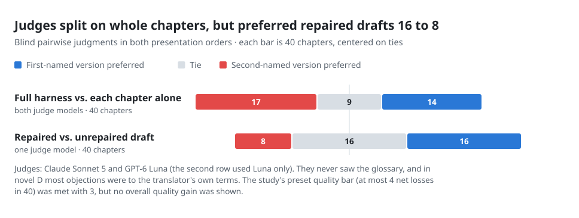
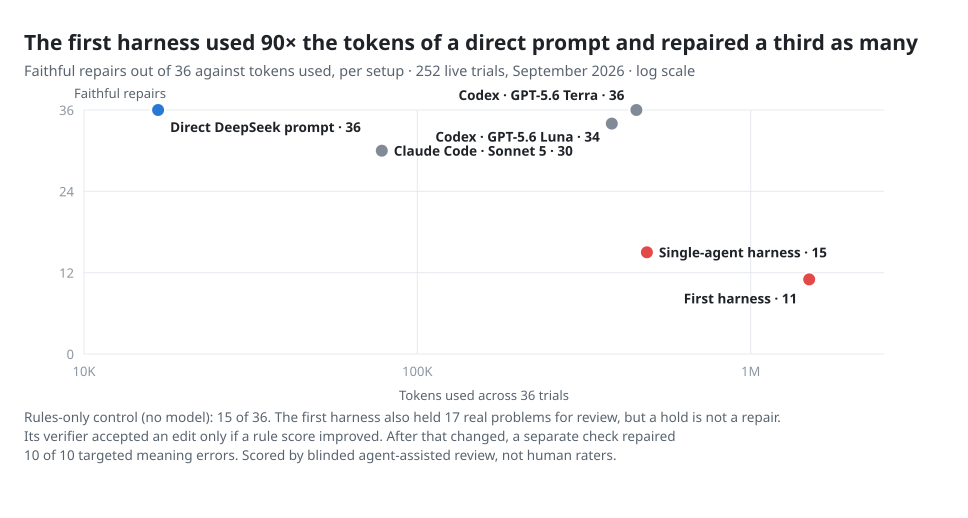
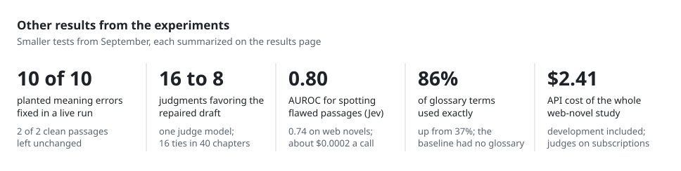

# Results and methods

The current evidence sequence is: the September combined harness study,
Stage 1's separation of memory from the glossary, and Stage 2's fresh-block
replication and smaller memory pack. Each test fixed its design and decision
rules before scored generation. Amendments and post-scoring corrections are
identified below. Results measure terminology consistency and specific checks;
overall translation-quality superiority has not been established.

The November studies are reported here as text. Their source chapters,
translations, study execution code, and per-term records remain private.
The existing [anonymous evidence bundle](../experiments/heldout_evidence/README.md)
recomputes **September's** aggregate counts, costs, and judge coverage:

```bash
python experiments/heldout_evidence/verify.py
```

That verifier checks aggregation of saved measurements. It does not validate
the underlying automatic extraction and does not verify the November studies.

## How to read the measures

A rendering is one chapter's English for a recurring source name or term.
Inconsistency is disagreement with that name's most common rendering in the
same setup. A consistently wrong or unwanted name can score well. Extraction
records one rendering per term per chapter, rather than checking every mention.

In November, each term's inconsistency rate is averaged within its novel,
then the three novels receive equal weight. Paired differences use names with
valid renderings in both setups. Missing or invalid extractions are excluded;
no output is counted as a successful rendering. Intervals are paired bootstrap
intervals over names within the fixed novels, not evidence of broad
population-level generalization from three independent works. September's
headline instead weights valid term–chapter observations.

## Stage 1 — November 2: isolate memory's contribution

**Design:** 60 unseen chapters, 20 consecutive chapters from each of three
novels, following five source-only lead-in chapters. The 120 frozen term units
are glossary families. Each family is hidden in one of two complementary
splits and supplied in the other. Supplied glossary names become available
only after their source introduction. The writer is DeepSeek Flash at
temperature 0, with one generation per assigned setup.

| Comparison | Inconsistency without memory | With memory | Relative reduction, 95% interval | Paired change, 95% interval |
| --- | ---: | ---: | ---: | ---: |
| No supplied glossary | 22.2% | 9.0% | 59% [48%, 71%] | −13.1 points [−16.9, −9.7] |
| Half glossary hidden, scored on hidden names | 22.7% | 8.9% | 61% [47%, 73%] | −13.8 points [−18.1, −9.5] |

Both primary comparisons use all 120 term units. Their better/same/worse
counts are 44/74/2 without a glossary and 44/71/5 on hidden glossary names.
The adjusted 97.5% intervals are respectively [−17.4, −9.2] and
[−18.7, −9.0] points; both confirmatory results survive the planned
multiple-comparison adjustment.

**Recent English history:** providing the previous five chapters' English
produced 14.2% inconsistency, against 9.2% for memory on the same 116 paired
units. Memory was better by 5.0 points [2.4, 7.8], outside the registered
±3-point equivalence margin. The history arm's format failure ended one
novel's chain in one split. A dated amendment completed the glossary-only
and glossary-plus-memory split without rerunning successful history outputs.
Its missing history coverage remains visible in the smaller denominator.

**Other checks:** repeating the no-memory setup moved its score by 1.3 points,
compared with an approximately 13-point memory effect. Supplied glossary
names matched exactly 89.8% of the time with memory and 88.5% without.
These exact matches measure compliance with supplied choices, not correctness.

**Resources:** the memory comparison cost about $0.0085 per chapter versus
$0.0017 without memory. Recent English history cost about $0.0068 per chapter.
The whole study cost $2.08 across 1,310 calls, including scoring work. Prices
and timings describe those runs and settings; they are not current promises.

**Limits:** one writer, three fixed novels, an LLM rendering extractor whose
human validation is pending, and an unrun meaning-error guardrail. Stage 1
used names and facts in its memory pack. Its hidden-glossary result has not
been replicated with the current names-only default and supplied glossary.

## Diagnosis: delivery, ignored names, and the memory pack

A retrospective analysis found that memory's name reached the prompt in only
25 of 78 checked occurrences in the earlier study. The runtime changed to
provide known names during extraction, increase term slots, and preserve
compatible compounds when they overlap a supplied glossary entry.

A development pilot increased delivery from 151/349 to 231/349 occurrences
(43.3% to 66.2%). No-glossary consistency was 78.0% for chapter-only generation,
83.0% with old memory, and 87.5% with the revised memory. These development
results motivated Stage 1; they are not another held-out confirmation.

A later audit used saved snapshots and rendering records without new model
calls. Of 51 residual inconsistent hidden-name renderings:

| Observed cause | Count |
| --- | ---: |
| Writer received memory's name and used another | 25 |
| Memory had not learned the name | 13 |
| Memory knew a longer or shorter source variant | 7 |
| Writer followed memory, but most chapters used another name | 6 |

In 23 of the 25 ignored-line cases, memory's name was the term's majority
rendering. This is evidence about self-consistency, not semantic correctness.
A proposed extra header covered none of the relevant missing-line occurrences,
so it was dropped. An offline name-adjudication pass remains planned.

Facts occupied 81–88% of memory's prompt characters. When the budget filled,
retained facts were typically older than omitted facts. A 15-chapter
development pilot reduced memory payload from about 2,449 to 217 characters
with a names-only pack, without an observed increase in its naming or judged
character-error checks. Stage 2 tested that simplification on fresh chapters.

## Stage 2 — November 7: replicate and simplify

**Design:** 60 fresh chapters from the same three novels, 20 per novel,
with no writer glossary. A fixed inventory contains 120 names. Three memory
conditions compare a five-chapter lead-in, a 20-chapter lead-in, and the
same 20-chapter memory with facts omitted from the injected pack. Facts are
still extracted and stored. Each-chapter-alone generation provides the
comparison; the names-only condition reuses the longer-lead-in condition's
memory and baseline outputs.

| Question and paired comparison | Inconsistency | Paired difference, 95% interval | Better / same / worse names | Decision |
| --- | ---: | ---: | ---: | --- |
| Replication: each chapter alone → names and facts, five-chapter lead-in | 24.7% → 11.4% | −13.2 points [−17.6, −8.9] | 54 / 56 / 9 (119 units) | Improvement rule holds; 54% fewer |
| Pack: names and facts → names only, both with 20-chapter lead-in | 11.3% → 9.8% | −1.4 points [−3.1, −0.01] | 10 / 102 / 4 (116 units) | Noninferiority rule holds |
| Lead-in: five → 20 chapters, names and facts | 11.4% → 11.3% | −0.1 points [−2.5, +2.4] | — | Improvement rule fails |

The pack rule required the upper interval bound to be below +1.5 points and
no more than three additional judged character errors. It passed: one blind
GPT-6 Luna judge found ten errors with names and facts and eight with names
only on the 59 matched chapters. Its categories cover pronouns, titles/ranks,
relationships/forms of address, and actions attributed to the wrong character.
These limited counts do not establish equivalent overall translation quality.
The registered test was noninferiority; the small observed consistency gain
is not claimed as a confirmatory superiority result.

| Corrected secondary measure | Five-chapter lead-in, names and facts | 20-chapter lead-in, names and facts | 20-chapter lead-in, names only |
| --- | ---: | ---: | ---: |
| Memory characters per passage | 2,870 | 2,862 | 392 |
| Name occurrences receiving memory's line | 87.7% | 93.2% | 93.2% |
| Judged chapters | Not judged | 60 | 59 |
| Judged character errors on matched chapters | — | 10 | 8 |
| Estimated memory-run cost per chapter | $0.0058 | $0.0072 | $0.0063 |

Names-only reduces memory's injected text by 86.3%, not total prompt size or
cost. The longer lead-in improves delivery but does not meet the registered
consistency-improvement rule, so it remains optional. Stage 2 cost $1.22 in
DeepSeek calls, including rendering extraction; the 119 judge calls used a
subscription and are outside that API total.

**Missing outputs and amendments:** one chapter-only output failed in the
short-lead-in run; one memory output failed in the names-only run. Neither
was retried for a favorable score. Replication therefore pairs 119 names and
the pack comparison 116; character-error exposure is matched at 59 chapters.
Configuration and budget setup were corrected before scored calls. Before
scoring, a recorded scorer amendment corrected an empty-comparison guard,
a bootstrap percentile index, and the cost denominator without changing the
measures or thresholds.

**Post-scoring correction:** the first delivery/pack calculation read context
for a different setup, producing impossible zero delivery. It was replaced
with the memory-only writer's actual supplied lines and associated facts.
The corrected values appear above, together with character errors restricted
to matched chapters. The registered pass/fail decisions did not use the
incorrect delivery/pack measure and were unaffected. Separate LLM extraction
passes over identical baseline text also produced slightly different counts;
that extractor noise is retained rather than silently reconciled.

**Current-runtime boundary:** names-only is now the demo and book default.
The reviewer also receives that context, although Stage 2 tested the writer.
Its effect on review quality remains untested. Stage 2 is a replication on
new chapter blocks, not on new novels or a second writer model.

## Alignment pilots: post-draft patches were not adopted for memory names

Four registered development pilots tested forcing missing names into saved
drafts, then diagnosed whether damage came from the name or the edit method.
The initial memory-name alignment raised name following from 88.5% to 91.3%
but lowered consistency from 87.6% to 84.9%. A follow-up also judged many
translator-name patches worse, so the initial inference that memory's names
were themselves wrong was withdrawn.

With the alternative names treated as equal, one blind judge rated 29/42
word-swap patches worse, eight better, and five the same. Whole-sentence
rewrites were less often judged worse (21/45), but only seven were better,
and they fixed fewer targeted names: 40/126 versus 53/126. The sentence-rewrite
proposal failed both adoption checks. Drafts were reused, the pilots were
small, and human confirmation of the judge is pending.

The alignment pass now targets the translator's supplied names rather than
automatically enforcing memory names. This narrows its scope; it does not
establish that the remaining word-swap method is harmless. The next proposed
adherence test changes the writer's input before the draft.

## September 2026: historical combined-harness study

**Design:** 40 chapters, ten from each of four novels unused in development,
after five source-only lead-in chapters. Every setup uses DeepSeek Flash at
temperature 0, thinking disabled. A 160-term recurring inventory and the
comparison were fixed before held-out generation. The context setup combines
memory with a series glossary; the full setup adds alignment and review and
repair routed by Jev, a small classifier that scores each passage's risk and
sends only risky passages to full review. There is no glossary-only
comparison.

| Measure | Each chapter alone | Memory + glossary | Full harness | Review everything |
| --- | ---: | ---: | ---: | ---: |
| Modal / valid renderings | 561 / 851 | 734 / 854 | 744 / 853 | 744 / 854 |
| Consistency | 65.9% | 85.9% | 87.2% | 87.1% |
| Attempted observations minus valid extractions | 6 | 3 | 4 | 3 |
| Terms rendered multiple ways, out of 160 | 116 | 61 | 62 | 63 |

Inconsistency falls from 290/851 to 109/853: **62.5% fewer**. All four works
improve, by 15.3–27.4 percentage points. The work-cluster bootstrap interval
for the paired per-term gain is 16.7–25.1 points; four works are too few for
strong population-level inference.

<picture>
  <source media="(prefers-color-scheme: dark)" srcset="../assets/readme/terms-dark.svg">
  
</picture>

<picture>
  <source media="(prefers-color-scheme: dark)" srcset="../assets/readme/novels-dark.svg">
  
</picture>

Memory plus the glossary accounts for about 94% of the observation-weighted
gain. A later origin analysis places 181/183 extra consistent occurrences
among supplied-glossary terms. This is retrospective attribution; without a
glossary-only control, it does not isolate a causal glossary effect. Review
and repair adds +1.1 points per term [−0.8, +2.3]. Of 72 terms rendered at
least three ways by chapter-only generation, 39 use one rendering in the full
harness. The public bundle recomputes those transition counts.

<picture>
  <source media="(prefers-color-scheme: dark)" srcset="../assets/readme/drift-dark.svg">
  
</picture>

### Quality, glossary adherence, cost, and coverage

| Blind comparison | Wins | Ties | Losses |
| --- | ---: | ---: | ---: |
| Memory + glossary vs chapter only | 14 | 8 | 18 |
| Full harness vs chapter only | 14 | 9 | 17 |
| Full vs its unrepaired draft, GPT-6 Luna only | 16 | 16 | 8 |

Complete two-order votes from both judge families exist for 34/40 full-versus-chapter-only
 pairs and 33/40 context-versus-chapter-only pairs. Remaining
pairs use one complete family vote; all assigned chapters stay in the counts.
The judge families are Claude Sonnet 5 and GPT-6 Luna. Judges did not see the
glossary. Across repeated presentation orders, 143/220 verdicts agreed.
Overall quality superiority was not established, and the net-preference
interval is wide (−42.5% to +20.0%).

<picture>
  <source media="(prefers-color-scheme: dark)" srcset="../assets/readme/judges-dark.svg">
  
</picture>

For the 143 terms with glossary references, reported exact adherence was
37.0% for chapter only, 84.4% for context, and 86.0% for the full harness.
The plan specified permissive overlap; a later audit promoted the already
computed exact-match measure. Integer match numerators are absent from the
public bundle, so these percentages are documentary rather than verifier-certified
 results. Adherence measures compliance with chosen vocabulary.

Historical estimated API cost per chapter was $0.0021 for chapter only,
$0.0066 for context, $0.0168 for routed full repair, and $0.0152 for reviewing
every passage. These use dated off-peak rates and exclude judging. All setups
delivered 40 chapters, but full repair carried warnings on 31, and review-everything
 on 37. Warnings indicate unresolved checks rather than confirmed
errors. Jev spotted flawed passages well (AUROC 0.80 overall, 0.74 on web
novels, about $0.0002 a call), but its routing thresholds didn't carry over: it
routed 62% of held-out passages versus 38% in development, so it cost more than
reviewing everything. No Jev cost or general quality advantage was
established. The whole September study, development included, cost $2.41 in
API charges, with judging run on subscription tools.

## Earlier engineering studies and authored checks

- **Repair trials:** across 252 trials, the original strict verifier delivered
  11/36 faithful repairs versus 36/36 for direct prompting. Allowing QA-neutral
  changes with fresh source review subsequently fixed 10/10 planted meaning
  errors while leaving two clean controls unchanged. Those are bounded
  authored checks.
- **Harness lab:** on the same six chapter drafts and guarded tools, a
  DeepSeek loop kept no edits, Claude Code kept nine, and Codex kept 16.
  Models and judges differed. The result describes behavior, not a ranking;
  that historical CLI/MCP surface is outside the current supported runtime.
- **Five-chapter benchmark:** repair cleared 68 deterministic rule findings;
  blind preference was seven for baseline, five for harness, and eight ties.
  The retired benchmark is a historical mechanical-QA result.
- **Authored memory fixture:** glossary-only and memory term-window checks
  tied at 34/34 in development and 13/13 in confirmation. Human fact ratings
  remain pending. This demonstrates mechanics, not an incremental quality gain.
- **Naming preferences:** same-series approved examples improved agreement
  with recorded choices by ten points on 60 fresh terms; cross-novel transfer
  was +2.1 points with uncertainty including zero. A separate 120-query test
  found 67/120 matches versus 50/120 with guidance alone. Batching those
  queries reduced input tokens by 86.8%, under that comparison's registered
  agreement margin. These are preference and efficiency results, not chapter
  correctness. In the later taste experiments (November 3), when three models
  named a term blind and agreed, it was my glossary's name 88% of the time
  (101 of 115 terms). That exploratory work remains human-unvalidated.

<picture>
  <source media="(prefers-color-scheme: dark)" srcset="../assets/readme/repair-trials-dark.svg">
  
</picture>

<picture>
  <source media="(prefers-color-scheme: dark)" srcset="../assets/readme/highlights-dark.svg">
  
</picture>

## Remaining validation

Human validation of rendering extraction, the Stage 1 meaning-error guardrail,
a blind naming self-test, and a human check of the alignment judge remain
pending. Recorded calls and exact source quotations support traceability;
they do not independently establish semantic truth or literary quality.

[How it works](HOW_IT_WORKS.md) · [Memory](MEMORY.md) ·
[Try it](TRY_IT.md) · [Data notice](../DATA_NOTICE.md)
